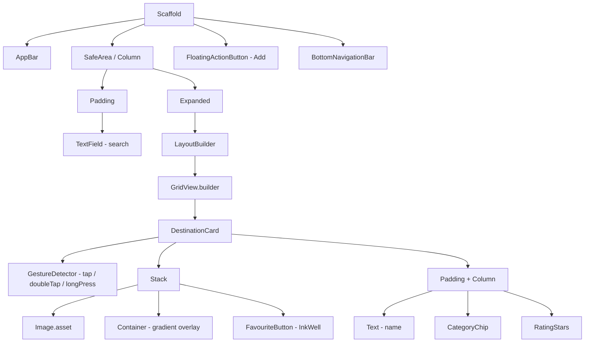
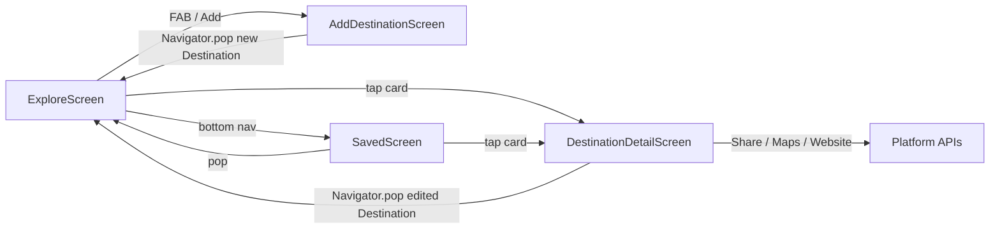

# Wanderly — Project Specification Document

**Deliverable 1 — Preparation Phase**

| Field | Value |
|---|---|
| Project | Wanderly — Personal Travel Bucket List |
| Document version | 1.0 |
| Date | 27 November 2026 |
| Team | _[Student A]_, _[Student B]_ (pair work) |
| Status | Draft for tutor review |
| Target platform | Flutter 3.x / Dart 3.x — Android & iOS |
| Development environment | VS Code + Android Studio SDK + Flutter/Dart SDK |

---

## 1. Project Overview

**Wanderly** is a cross-platform mobile application for discovering, organising and
tracking places a user wants to visit. It combines a browsable catalogue of travel
destinations with a lightweight personal "bucket list": users explore destination
cards, open rich detail views with real-world map and web links, add their own
destinations through a guided form, and curate a favourites list.

**Core domain.** The domain is *travel destination curation*. The central entity is a
`Destination`, which carries descriptive data (name, country, category, short
description, image), geographic data (latitude/longitude), web references (website
URL), and user-specific state (favourite flag, visited flag, personal rating).

**Key value proposition.** Generic map and booking apps overwhelm users with choice
and are optimised for transactions. Wanderly is deliberately *personal and calm*: it
gives the user one focused list of "places I care about", with fast gestural control
(double-tap to save, swipe to remove) and one-tap access to external context (maps,
official site, share). It demonstrates that a small, well-architected Flutter app can
deliver a complete, polished interaction model without a backend.

**Technical character.** The application is entirely local-state driven: no server,
no authentication, no network persistence. All data lives in an in-memory repository
seeded with deterministic sample data, with an optional `shared_preferences` adapter
for persistence between launches. This keeps the project focused on the assessed
Flutter concepts — widget composition, state management, event handling, gestures and
navigation — while still exercising device/platform APIs through `url_launcher` and
`share_plus`.

---

## 2. Problem Statement and Proposed Solution

### 2.1 Problem statement

Travellers typically research destinations scattered across browser tabs, map apps,
screenshot folders and notes. The friction points are:

1. **Fragmentation** — candidate destinations are not collected in one structured place.
2. **Heavy interaction cost** — saving or removing an idea normally requires opening
   a detail page, finding a menu, and confirming; there is no quick gestural path.
3. **Lost context** — a saved place often lacks its coordinates, official website and
   a way to share it with a travel companion.
4. **No prioritisation** — users cannot mark a place as visited or rate it at the
   moment of discovery.

### 2.2 Proposed solution

Wanderly addresses these with a three-part architectural solution:

- **A unified catalogue screen** (`ExploreScreen`): a responsive `GridView` of
  destination cards with an inline search `TextField`, so the full shortlist is
  visible and filterable at a glance.
- **A gesture-first interaction layer**: reusable card widgets wrap actions in
  `GestureDetector`/`InkWell` — single tap opens the detail view, double-tap toggles
  the favourite state with immediate visual feedback, long-press opens a contextual
  delete confirmation, and the saved list supports swipe-to-remove.
- **A detail + creation flow**: `DestinationDetailScreen` exposes platform actions
  (open in maps, open website, share), and `AddDestinationScreen` captures new ideas
  through a validated form that returns a fully constructed `Destination` model to
  the catalogue via `Navigator.pop`.

The separation of concerns is enforced by the directory structure: pure data in
`models/`, reusable presentational and interactive units in `widgets/`, and
screen-level composition and orchestration in `screens/`.

---

## 3. Target Users

### Persona 1 — "The Inspired Planner" (primary)
- **Profile:** 25–35, urban, plans one or two trips per year, researches heavily online.
- **Environment:** commutes and lunch breaks; phone in one hand; short sessions.
- **Needs:** quickly capture a place seen on social media, keep it organized by
  category, and open the map when reconsidering it later.
- **Behaviour in app:** browses Explore, double-taps to save, adds a few custom entries
  with the form, revisits Saved before booking.

### Persona 2 — "The Weekend Explorer" (secondary)
- **Profile:** 18–28, spontaneous, travels with friends.
- **Environment:** on the move, often sharing suggestions in a group chat.
- **Needs:** send a place to friends in one action; check "visited" status.
- **Behaviour in app:** opens Detail, uses Share, marks destinations visited, and
  swipes old ideas out of the Saved list.

### Persona 3 — "The Returning Traveller" (tertiary)
- **Profile:** 35+, keeps a mental record of past trips.
- **Environment:** at home, longer reflective sessions.
- **Needs:** rate and revisit past destinations, filter by category.
- **Behaviour in app:** uses the rating control on Detail, searches by name/country,
  maintains the visited flag from the Saved list.

**Accessibility note.** All personas may interact one-handed or in bright outdoor
conditions. The UI therefore uses large touch targets (minimum 48×48 dp), high-contrast
text, semantic labels for screen readers, and visible selected states for all selection
controls.

---

## 4. Functional Requirements

Priorities: **H** = high (must ship), **M** = medium, **L** = low (nice to have).

### 4.1 Core catalogue

| ID | Priority | Requirement |
|---|---|---|
| FR-01 | H | Display all destinations in a responsive `GridView` (2 columns on phones, more on wider layouts via `LayoutBuilder`). |
| FR-02 | H | Each card renders a local `Image.asset`, name, country, category chip and rating via `RatingStars`. |
| FR-03 | H | Provide a search `TextField` that filters the grid by name or country as the user types (`onChanged`). |
| FR-04 | M | Show an `EmptyState` widget when a search returns no results or the list is empty. |

### 4.2 Gestural interaction

| ID | Priority | Requirement |
|---|---|---|
| FR-05 | H | Single tap on a card opens the detail screen, passing the full `Destination` object as a constructor argument. |
| FR-06 | H | Double-tap on a card toggles its favourite state with immediate visual feedback (filled heart + scale animation). |
| FR-07 | H | Long-press on a card opens a confirmation dialog before removing it from the list. |
| FR-08 | H | In the Saved screen, swipe horizontally (`Dismissible`) removes a destination with an undo-capable confirmation pattern. |

### 4.3 Detail view

| ID | Priority | Requirement |
|---|---|---|
| FR-09 | H | Render a `Stack` hero image with a gradient overlay and title/country text. |
| FR-10 | H | Display description, category, personal rating and visited/favourite status using `Row`/`Column`/`Padding`/`Container` composition. |
| FR-11 | H | "Open in Maps" button launches a maps URL through `url_launcher`. |
| FR-12 | H | "Visit website" button launches the destination's URL through `url_launcher`. |
| FR-13 | H | "Share" button invokes the platform share sheet via `share_plus`. |
| FR-14 | M | A favourite toggle (`InkWell`) lets the user save/unsave from the detail view. |

### 4.4 Creation form

| ID | Priority | Requirement |
|---|---|---|
| FR-15 | H | `TextField` inputs for destination name and country; both required. |
| FR-16 | H | `RadioGroup` selection for category (Beach / City / Mountain / Culture). |
| FR-17 | H | `Checkbox` for the "already visited" flag. |
| FR-18 | H | `ElevatedButton` validates and submits; `TextButton` cancels the flow. |
| FR-19 | M | Validation errors are shown inline and the submit button is disabled until required fields are valid. |
| FR-20 | H | On submit, build a `Destination` and return it with `Navigator.pop(context, destination)`; Explore inserts it into its list. |

### 4.5 Saved list

| ID | Priority | Requirement |
|---|---|---|
| FR-21 | H | `ListView` of favourited destinations with reusable `DestinationCard` rows. |
| FR-22 | H | `Checkbox` on each saved row toggles the visited flag directly. |
| FR-23 | M | Tapping a saved row navigates to Detail with the model, and edits propagate back on `pop`. |

### 4.6 Cross-cutting / non-functional

| ID | Priority | Requirement |
|---|---|---|
| FR-24 | H | Material 3 theming with an ocean-teal primary palette and warm-coral accent; light and dark themes. |
| FR-25 | H | All interactive elements have `Semantics` labels/tooltips and ≥48 dp touch targets. |
| FR-26 | H | Layouts adapt to screen width using `LayoutBuilder`/`MediaQuery`; no overflow at 360 dp width. |
| FR-27 | M | Data persists across restarts using `shared_preferences` when available, with graceful in-memory fallback. |
| FR-28 | L | Simple entry animation when cards appear (optional polish). |

---

## 5. Data Models

```dart
enum Category { beach, city, mountain, culture }

class Destination {
  final String id;
  final String name;
  final String country;
  final Category category;
  final String description;
  final String imagePath;
  final double latitude;
  final double longitude;
  final String? websiteUrl;
  final double rating;        // 0.0 – 5.0
  bool isFavourite;
  bool isVisited;

  Destination({ ... });       // constructor
  Destination copyWith({ ... }); // immutable-style updates
  Map<String, dynamic> toJson();
  factory Destination.fromJson(Map<String, dynamic> json);
}
```

- `category` is an `enum` to make `Radio` values type-safe and serialisation explicit.
- `websiteUrl` is nullable: the form does not require it, and Detail hides the website
  button when absent (satisfying the "no invented numbers/links" rule — missing data is
  represented as absent, not fabricated).
- `copyWith` supports state updates without mutating models held by other screens.

**Repository.** A `DestinationRepository` class owns the single in-memory list and
exposes `all()`, `add()`, `remove()`, `update()`, and `toggleFavourite()`. Screens
receive the repository through constructor injection, keeping screens testable.
The seed data is deterministic (8–10 hand-written destinations) so screenshots are
reproducible.

---

## 6. Application Structure

### 6.1 Directory layout

```text
wanderly/
├── android/ , ios/                  # platform runners
├── assets/
│   ├── images/                      # local destination images (Image.asset)
│   │   ├── beach.jpg
│   │   ├── city.jpg
│   │   ├── mountain.jpg
│   │   └── culture.jpg
│   └── icons/                       # optional custom vector/PNG icons
├── lib/
│   ├── main.dart                    # app entry, MaterialApp, theme, routes
│   ├── models/
│   │   ├── destination.dart
│   │   └── category.dart
│   ├── repositories/
│   │   └── destination_repository.dart
│   ├── screens/
│   │   ├── explore_screen.dart      # StatefulWidget
│   │   ├── destination_detail_screen.dart  # StatelessWidget
│   │   ├── add_destination_screen.dart     # StatefulWidget
│   │   └── saved_screen.dart        # StatefulWidget
│   ├── widgets/
│   │   ├── destination_card.dart    # GestureDetector + Dismissible support
│   │   ├── favourite_button.dart    # InkWell, animated feedback
│   │   ├── rating_stars.dart        # StatelessWidget
│   │   ├── category_chip.dart       # StatelessWidget
│   │   ├── section_header.dart      # StatelessWidget
│   │   └── empty_state.dart         # StatelessWidget
│   └── theme/
│       └── app_theme.dart           # ColorScheme, light/dark ThemeData
├── test/
│   ├── models/destination_test.dart
│   └── repositories/destination_repository_test.dart
├── pubspec.yaml                     # deps: url_launcher, share_plus, shared_preferences
└── README.md
```

### 6.2 Widget composition map (Explore screen)



**State ownership.** `ExploreScreen` is stateful because it owns the search query,
the destination list snapshot and favourite toggles. `DestinationDetailScreen` is
stateless — it receives a `Destination` and renders it; the only interactive state
there (the favourite toggle) is lifted into the repository/callback passed in.
`DestinationCard`, `RatingStars`, `CategoryChip` and `EmptyState` are stateless
presentational widgets, demonstrating the required distinction between static layout
and reactive component state.

---

## 7. Application Structure and Navigation

### 7.1 Routing map

| Route | Screen | Arguments | Return value |
|---|---|---|---|
| `/` | `ExploreScreen` | `DestinationRepository` | — |
| `/detail` | `DestinationDetailScreen` | `Destination` (constructor arg) | `Destination?` (edited model) |
| `/add` | `AddDestinationScreen` | none | `Destination?` (new model) |
| `/saved` | `SavedScreen` | `DestinationRepository` | — |

Navigation uses explicit `Navigator.push` / `Navigator.pop` with typed constructor
arguments — no string-based `Navigator.of(context).pushNamed` — so the data-passing
contract is checked at compile time.

### 7.2 Navigation flow diagram



### 7.3 Data-passing flows

1. **Explore → Detail.** The tapped `Destination` instance is passed to
   `DestinationDetailScreen(destination: d, onFavouriteChanged: ...)`. Detail is a
   pure consumer; any change is reported back through the callback and applied to the
   repository, so Explore's grid rebuilds with the new state.
2. **Explore → Add → Explore.** `Navigator.push` awaits the result:
   `final created = await Navigator.push<Destination>(...)`; on a non-null result,
   `setState(() => repository.add(created))` refreshes the grid.
3. **Saved → Detail → Saved.** Saved passes its own model; when Detail pops an edited
   model, Saved updates the corresponding entry via `repository.update()`.
4. **Repository as shared source of truth.** All screens read from the same injected
   repository instance, so mutations in one screen are visible in the others without
   a global singleton or a state-management package.

---

## 8. Theme and Visual Language

| Token | Value | Usage |
|---|---|---|
| Primary | Ocean teal `#0F766E` | AppBar, buttons, selected nav item, focus rings |
| Primary container | `#CCFBF1` | Selected chips, card highlights |
| Accent / secondary | Warm coral `#F97362` | Favourite heart, rating stars, FAB |
| Background | `#F7FAF9` (light) / `#0B1416` (dark) | Scaffold background |
| Surface | white / `#142024` | Cards, dialogs |
| On-primary | white | Text on primary |
| Error | `#B3261E` | Validation messages, delete confirmations |
| Shape | 16 dp card radius, 12 dp button radius | Soft, friendly geometry |
| Typography | Material 3 `bodyLarge` / `titleLarge` / `headlineSmall` | Consistent hierarchy |

Accessibility: contrast ratios meet WCAG AA for text; icons always paired with text
or `Semantics` labels; ripples (`InkWell`) provide visible touch feedback.

---

## 9. Requirement Traceability Matrix

This matrix shows where each assessed Flutter requirement is addressed.

| Assignment requirement | Implementation location |
|---|---|
| ≥3 screens, modular `models/ widgets/ screens/` | §6.1, §7.1 — 4 screens, 3 top-level dirs |
| `StatelessWidget` + `StatefulWidget` | §6.2 — Explore/Add/Saved stateful; Detail/Card/Chip stateless |
| Rows, Columns, Stacks, Padding, Containers | Detail hero `Stack`; card info `Column`; form `Column`+`Padding` |
| TextField, Radio, Checkbox, TextButton, ElevatedButton | §4.4 — FR-15–FR-20 |
| onPressed / onChanged / onTap handlers | search `onChanged`, buttons `onPressed`, cards `onTap` |
| GestureDetector / InkWell: tap, double-tap, long-press, swipe | §4.2 — FR-05–FR-08 |
| `Image.asset`, vector icons, themes | §6.1 assets, §8 theme |
| `GridView` / `ListView` | FR-01 (grid), FR-21 (list) |
| `Navigator.push` / `pop` with model args | §7.2–§7.3 |
| url_launcher / maps / share_plus | FR-11–FR-13 |
| Responsive + accessible | FR-24–FR-26, §8 |

---

## 10. Scope and Exclusions

**In scope:** local catalogue, search, favourites, custom destination creation,
detail view with platform actions, saved list, light/dark theming, accessibility.

**Out of scope (explicitly deferred):** user accounts/authentication, remote API or
database sync, real geocoding service, offline map tiles, booking/payment flows,
push notifications. These are excluded to keep the 4-week, pair-work scope focused on
the assessed Flutter concepts.

---

## 11. Delivery Milestones (4 weeks)

| Week | Focus | Exit criterion |
|---|---|---|
| 1 | Spec sign-off, Flutter project scaffold, models, repository, theme, seed data | `flutter test` green for model/repository tests |
| 2 | Explore + Detail screens, cards, gestures, url_launcher/share | Both screens navigable; all gestures produce visible feedback |
| 3 | Add form + Saved list, swipe-to-delete, persistence adapter | Full round trip: add → detail → save → delete |
| 4 | Accessibility pass, responsive checks, screenshots, AI Integration Report, README | All deliverables complete; app builds on Android & iOS simulator |

---

## Appendix A — Seed Data Categories

| Category | Example destinations |
|---|---|
| Beach | Bali, Amalfi Coast, Copacabana |
| City | Kyoto, Lisbon, New York |
| Mountain | Banff, Dolomites, Patagonia |
| Culture | Cairo, Istanbul, Cusco |

## Appendix B — Required Assets

- Four category images (`beach.jpg`, `city.jpg`, `mountain.jpg`, `culture.jpg`) stored
  in `assets/images/` and declared in `pubspec.yaml` under `flutter: assets:`.
- Material icons used throughout (`Icons.favorite`, `Icons.map`, `Icons.language`,
  `Icons.share`, `Icons.add`, `Icons.search`, `Icons.bookmark`).

---

_End of specification._
