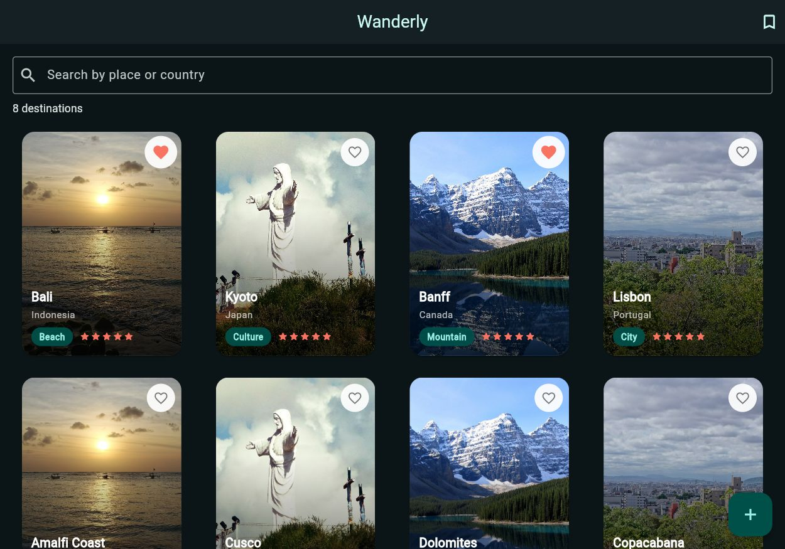
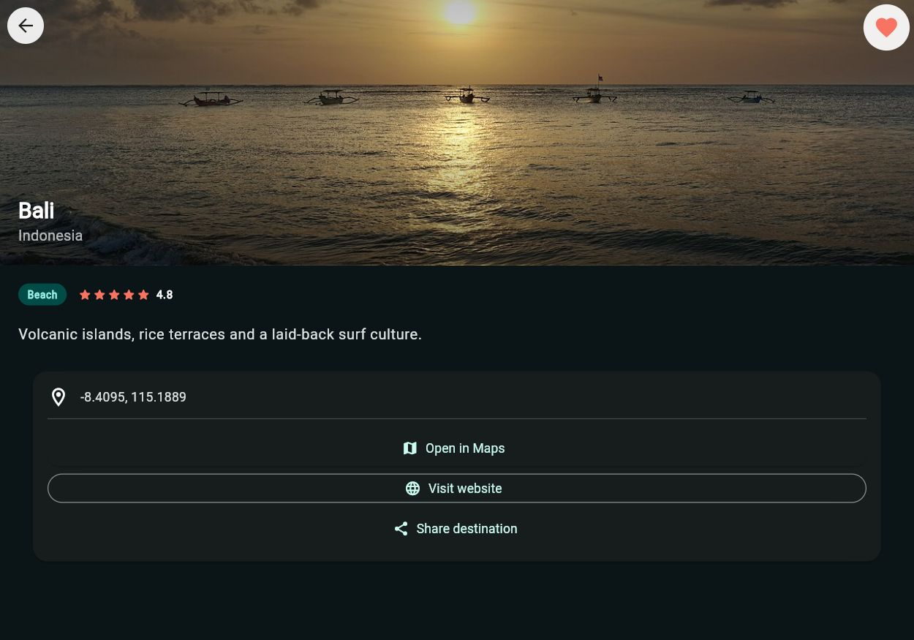
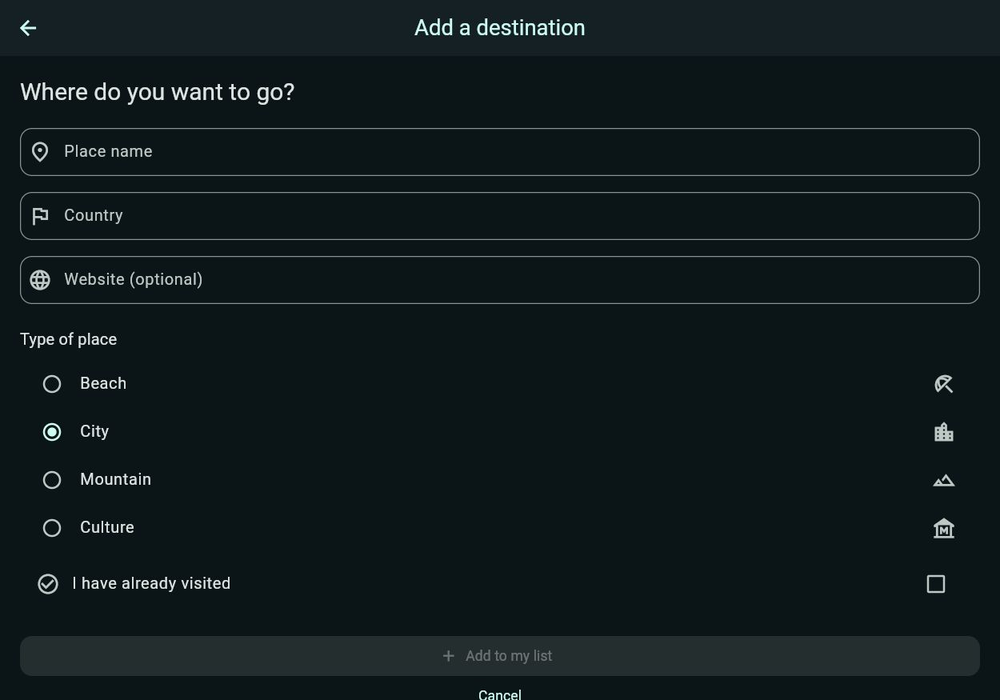
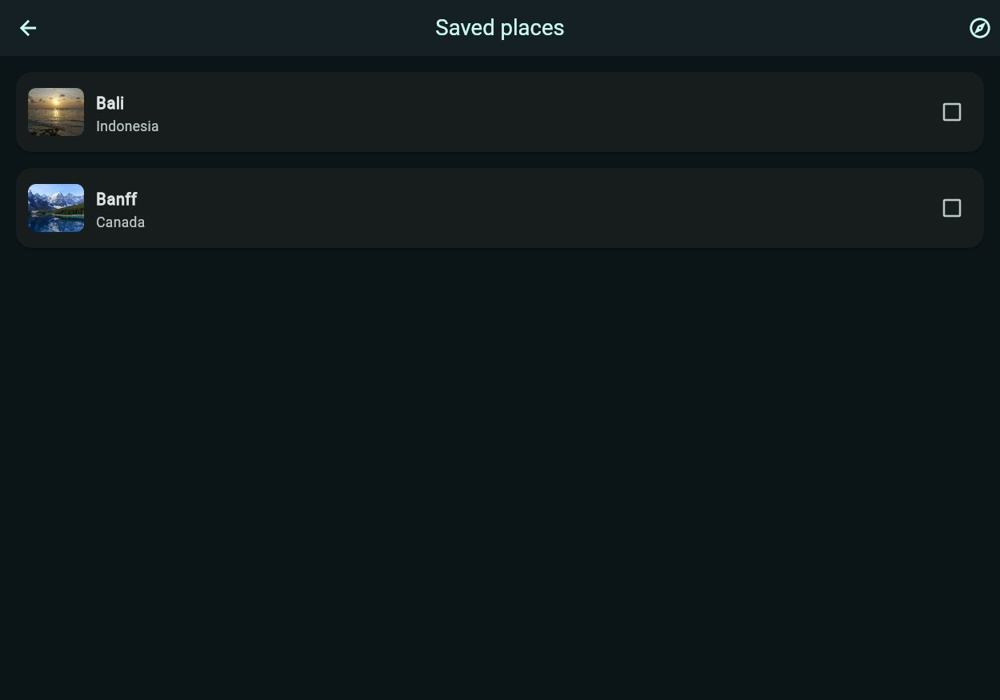

# Wanderly — Application Screenshots Report

**Deliverable 4 — Application presentation**

| Field | Value |
|---|---|
| Build | Flutter 3.50.1 / Dart 3.14.0, debug build |
| Capture method | Flutter web runner (`flutter run -d web-server`) viewed in Chromium |
| Viewport | 1000 × 700 CSS px (screenshots scaled to 1230 × 844), DPR 1.25 |
| Theme | Material 3 dark, ocean teal + warm coral |
| Date | 27 November 2026 |

> The Android SDK was not installed on the capture machine, so screenshots were
> taken from the Flutter web build. The same widget tree, state logic and
> navigation code are used on Android and iOS; only the host platform differs.

---

## Screen 1 — Explore (catalogue)

**Function.** The landing screen and primary browsing surface. It shows all eight
seed destinations in a responsive `GridView` with local photos, name, country,
category chip and star rating. A search `TextField` filters results as the user
types, and a live count reports the number of matches.

**Components.**
- `Scaffold` → `AppBar` (title + saved bookmark shortcut)
- `TextField` with `onChanged` listener driving the search query
- `ValueListenableBuilder` rebuilding on repository changes
- `LayoutBuilder` choosing 2–4 grid columns from available width
- `GridView.builder` of `DestinationCard` widgets
- `DestinationCard`: `GestureDetector` + `Stack` + `Image.asset` + gradient
  `DecoratedBox`, `FavouriteButton` (`InkWell`), `CategoryChip`, `RatingStars`
- `FloatingActionButton` for adding a destination
- `EmptyState` when the search has no results

**Navigation triggers.**
- Tap a card → `Navigator.push` to **Detail**, passing the `Destination` model.
- Double-tap a card → toggle favourite with an animated heart (immediate feedback).
- Long-press a card → `AlertDialog` confirmation, then remove from repository.
- Tap the heart → toggle favourite without opening detail.
- Tap the FAB → `Navigator.push` to **Add destination**.
- Tap the bookmark icon → `Navigator.push` to **Saved places**.

---

## Screen 2 — Destination detail

**Function.** A focused, read-only view of one destination with real-world
actions. It demonstrates `Stack` composition (hero photo, gradient overlay,
floating controls) and platform integration beyond local state.

**Components.**
- `Stack` with `Image.asset` hero and gradient overlay
- Back `IconButton` and `FavouriteButton` positioned over the image
- `Column` info section: `CategoryChip`, `RatingStars`, optional "visited" badge
- Description text with increased line height
- `Card` containing coordinates, **Open in Maps**, **Visit website** and
  **Share destination** buttons

**Navigation triggers / actions.**
- Back button → `Navigator.pop` to the previous screen.
- Heart → toggle favourite in the shared repository.
- **Open in Maps** → `url_launcher` with a Google Maps query built from
  latitude/longitude.
- **Visit website** → `url_launcher` with the destination URL (button hidden when
  no URL exists — missing data is not invented).
- **Share destination** → `share_plus` platform share sheet.

---

## Screen 3 — Add destination

**Function.** A validated form that captures a new destination and returns it to
the caller. The submit button stays disabled until the required fields are filled.

**Components.**
- `AppBar` with back navigation
- `Form` with `GlobalKey<FormState>` and `TextFormField` validators
- Three `TextField` variants: place name, country, optional website URL
- `RadioGroup<Category>` with four `RadioListTile` options
  (Beach / City / Mountain / Culture)
- `CheckboxListTile` for the visited flag
- `ElevatedButton` submit and `TextButton` cancel

**Navigation triggers.**
- **Add to my list** → build a `Destination` and `Navigator.pop(context, destination)`.
  Explore awaits the result and inserts it into the repository.
- **Cancel** or back → `Navigator.pop(context)` with no value.
- Radio and checkbox changes update local `StatefulWidget` state immediately.

---

## Screen 4 — Saved places

**Function.** The favourites list. It reuses the same repository as Explore, so
changes made on any screen are reflected here.

**Components.**
- `AppBar` with a "back to explore" action
- `ValueListenableBuilder` over the repository
- `ListView.builder` of `Dismissible` `Card` rows
- `ListTile` with thumbnail `Image.asset`, title, country and a visited `Checkbox`
- `EmptyState` with instruction when nothing is saved

**Navigation triggers / gestures.**
- Tap a row → **Detail**, passing that `Destination`; edits returned via `pop`
  update the repository.
- Swipe a row left → confirmation dialog, then remove with an undo-style snackbar.
- Checkbox → toggle the visited flag directly.
- App-bar explore icon → `Navigator.pop` back to Explore.

---

## Responsiveness and accessibility notes

- `LayoutBuilder` sets 2 columns on phone-width layouts and up to 4 on wider
  viewports; the card footer uses `Wrap` so category and rating flow onto a
  second line instead of overflowing.
- All controls have tooltips or `Semantics` labels, minimum 48 dp touch targets,
  and visible ripples/selected states.
- Both light and dark Material 3 themes are defined in `lib/theme/app_theme.dart`.
